# Components

Every Solid element in these repos: 27 custom elements and the kit bundle they run on. For each:
its source, its built bundle (`pnpm build` in its repo), where `pnpm db:setup` / `pnpm deploy:fieldtec`
put it in fieldtec-web, a picture, and the options its componentDefinition takes.

Bundle file names in `dist/` are stable. The component documents that load them add `?v=<content hash>`
to the URL, so a new build is never served from fieldtec-web's service worker cache.

Written by `node scripts/components-md.mjs --shots`. The options come from each element's TypeScript
definition interface and its doc comments, and the pictures from each repo's browser test page
(its fixtures, against the in-memory host), so both follow the code.

| Element | App | Version | What it does |
|---|---|---|---|
| [`<solid-approval-chain>`](#solid-approval-chain) | Shared | 0.1.0 | The people who must approve a record, in order, chosen by the app's rules (a line manager, then a second approver): who is next, approve or reject with a comment, delegation to someone else, and the decisions made. The rules check every change with the kit's approvalProblems. |
| [`<solid-checklist>`](#solid-checklist) | Shared | 0.2.0 | A check sheet (Daily Driver pre-start, service checks) answered Pass / Fail / N/A with comments, grouped by category, with progress and the sheet's result. Checks come from the definition or from a check sheet document the record points to (e.g. through its asset). |
| [`<solid-comments>`](#solid-comments) | Shared | 0.1.0 | A document's comment thread with Markdown, replies, edits and votes, stored like sc-note-comment (SDMS notesCommentsArr). |
| [`<solid-date-range>`](#solid-date-range) | Shared | 0.2.0 | When something starts and ends, bound to two fields. Date and time (bookings, workshop jobs): quick durations, the duration shown and the time range rules. Days (leave, rosters): first and last day, half days, working days counted without weekends and public holidays, shown as a strip of days. |
| [`<solid-image-pins>`](#solid-image-pins) | Shared | 0.1.0 | Numbered pins on a built-in body figure (front and back views made of named regions: where someone was hurt) or on any image (a floor plan, a drawing with defects). Each pin stores its position as fractions of the view, the region under it, a kind (its colour) and a note. |
| [`<solid-line-items>`](#solid-line-items) | Shared | 0.2.0 | Costs line by line (a work order's parts and labour, a purchase's goods, services and freight): kinds, a catalogue to pick from, quantities and unit costs, totals per kind, subtotal, tax and total from the kit's lineTotals. |
| [`<solid-lookup-picker>`](#solid-lookup-picker) | Shared | 0.1.0 | Single or multi pick from lookup documents (type, priority, severity, labels...) with icons. |
| [`<solid-map>`](#solid-map) | Shared | 0.1.0 | OpenLayers map of Formbird documents. Layers mode shows live searches (assets by type and hire status, sites with their boundaries) with popups and actions; point and area modes edit a document's location or boundary. Uses the page's openlayers-shared (global OL). |
| [`<solid-photo-capture>`](#solid-photo-capture) | Shared | 0.2.0 | Photos (or, with allowFiles, any files) on a record, taken or uploaded, downscaled, captioned, in a gallery with a lightbox; or, with layout "list", documents as rows with a type each (quote, invoice) and PDFs previewed in the lightbox. |
| [`<solid-record-key>`](#solid-record-key) | Shared | 0.1.0 | A record's reference number (TRK-12, REQ-0041) with its type icon and a copy-link button. Display only; the server assigns the number. |
| [`<solid-resource-schedule>`](#solid-resource-schedule) | Shared | 0.1.0 | People (or assets) by day: each row's records as bars across the days (leave, jobs, shifts), grouped by team with how many are left on each day against a minimum, weekends and public holidays shaded, figures per row (leave balances), and drag across free days to start a new record. |
| [`<solid-stat-tiles>`](#solid-stat-tiles) | Shared | 0.1.0 | Dashboard tiles, each a live Elasticsearch count (assets on hire, urgent defects, services due…) with a tone, a hint and a link to the list behind it. |
| [`<solid-status>`](#solid-status) | Shared | 0.1.0 | A workflow status as a coloured lozenge button offering only the allowed transitions, with an optional second step (resolution, cancellation reason) and transitions guarded by access keys. |
| [`<solid-table>`](#solid-table) | Shared | 0.1.0 | Documents from an Elasticsearch filter in a table, with typed columns (key, status, priority, people, labels, dates), server-side sorting and paging, search and CSV export. Accepts sc-datatables' main options. |
| [`<solid-user-picker>`](#solid-user-picker) | Shared | 0.1.0 | Assignee / reporter / watchers picker with avatars and 'Assign to me'. |
| [`<solid-issue-summary>`](#solid-issue-summary) | Issue tracker (internal) | 0.1.0 | Inline-editable issue title. |
| [`<solid-asset-summary>`](#solid-asset-summary) | Fleet | 0.1.0 | The header of an asset: type, ID, registration, lifecycle and hire status, meter, service due (date and meter) and registration warnings, with quick actions that start a booking, a Daily Driver check or a fault report for it. |
| [`<solid-booking-calendar>`](#solid-booking-calendar) | Fleet | 0.1.0 | The fleet booking calendar (assets by location × day or week, bookings by status, Hire Overdue, workshop block-outs; drag across free time to book) and, on a booking form, an availability assistant that shows clashes and offers free assets. |
| [`<solid-meter-reading>`](#solid-meter-reading) | Fleet | 0.1.0 | An odometer (km) or engine hours reading checked against the asset's current meter and an optional start reading, with the change since the asset's last reading. |
| [`<solid-corrective-actions>`](#solid-corrective-actions) | Work health and safety | 0.1.0 | The corrective actions raised against an incident, hazard or inspection, listed live with their control level, owner, due date and status, and a quick form to raise one. |
| [`<solid-risk-matrix>`](#solid-risk-matrix) | Work health and safety | 0.1.0 | A 5 × 5 likelihood × consequence matrix. Assess mode rates a risk field (rating, score and what the rating asks for), with the risk before controls as a ghost marker; heatmap mode counts records per cell and lists them. |
| [`<solid-root-cause>`](#solid-root-cause) | Work health and safety | 0.1.0 | A five-whys tree for an investigation: the problem, answers to "why?" that can branch, root causes with categories, and what the analysis still needs. |
| [`<solid-leave-balance>`](#solid-leave-balance) | HR | 0.1.0 | Leave balances worked out live from the opening balance, pro rata accrual and approved and pending requests. On a leave request: what is available on the first day, this request, and what is left after (writing the available days for the client rule). On a page: the signed-in person's balances as cards. |
| [`<solid-org-chart>`](#solid-org-chart) | HR | 0.1.0 | The organisation as a tree of people by whom they report to: cards with team colour, title, reports and who is on leave today; expand and collapse, search that opens the reporting line, zoom, and on a person's form their line and direct reports. |
| [`<solid-skills-matrix>`](#solid-skills-matrix) | HR | 0.1.0 | People × certificate types, each cell valid, expiring (days left), expired or missing against what the person's position requires, grouped by team, with compliance per person, per type and overall, a gaps-only view, search, CSV export, and a click to open or add the certificate. |
| [`<solid-budget-check>`](#solid-budget-check) | Procurement | 0.1.0 | A cost centre's budget for the financial year: spent, committed, waiting for approval and what is left, as a bar with the request on it. On a request: whether it fits, and the finance override it needs when it doesn't. On a page: every cost centre against how far through the year it is. |
| [`<solid-quote-compare>`](#solid-quote-compare) | Procurement | 0.1.0 | A purchase request's supplier quotes side by side: amount against the cheapest, lead time, validity, approved supplier, the quote document; how many quotes the amount needs; choose one; add a quote. |

## Common options

Every element takes these, as fieldtec-web's `sc-*` components do. `name` is the document field the
element reads and writes. Set `disableSave: true` on an element that only shows things.

| Option | Type | What it does |
|---|---|---|
| `filter` | `string \| Record<string, unknown>` | Elasticsearch request (string with single quotes and Handlebars, or an object set by a ruleset). |
| `relatedFields` | `Record<string, string>` | Extra fields copied from the selected document into the stored value: `{ storedKey: 'source.path' }`. |
| `queryOptions` | `{ pageSize?: number }` | `pageSize`: how many search results load at a time. |
| `helpDisplayString` | `string` | Placeholder shown when empty (sc-related-document name). |
| `noHelpDisplay` | `boolean` | Show no placeholder. |
| `componentName` | `string` | The element: its tag, `solid-…`. |
| `type` | `string` | Read by fieldtec-web; the Solid elements don't use it. |
| `name` | `string` | The document field the element reads and writes. |
| `label` | `string` | The label above the element. |
| `mandatory` | `boolean` | The field must have a value to save. Rules can change it (`mandateField`). |
| `defaultValue` | `string` | Read by fieldtec-web's form: the value of a new document. |
| `enabled` | `boolean` | `false` shows the value without letting it change. Rules can change it (`enableField`). |
| `fullWidth` | `boolean` | Read by fieldtec-web's form: the element takes the whole row. |
| `readOnly` | `boolean` | Show the value without letting it change. |
| `disableSave` | `boolean` | Read by fieldtec-web's form: the field is not saved. Set it on elements that only show things. |
| `disableDirty` | `boolean` | Read by fieldtec-web's form: a change doesn't mark the document unsaved. |
| `visible` | `boolean` | Read by fieldtec-web's form: `false` hides the element. Rules can change it (`showField`). |
| `skipRendering` | `boolean` | Read by fieldtec-web's form: the element isn't rendered. |
| `layout` | `string` | Read by fieldtec-web's form. (Photo capture has its own `layout` option.) |

## Shared

[`solidjs-components-shared`](solidjs-components-shared/README.md): Generic elements every app uses.

### `<solid-approval-chain>`

The people who must approve a record, in order, chosen by the app's rules (a line manager, then a second approver): who is next, approve or reject with a comment, delegation to someone else, and the decisions made. The rules check every change with the kit's approvalProblems.

| | |
|---|---|
| Package | `@solidjs-components/approval-chain` 0.1.0 · [README](solidjs-components-shared/components/approval-chain/README.md) |
| Source | [solidjs-components-shared/components/approval-chain/src/main.tsx](solidjs-components-shared/components/approval-chain/src/main.tsx) · [ApprovalChain.tsx](solidjs-components-shared/components/approval-chain/src/ApprovalChain.tsx) (`ApprovalChainDefinition`) |
| Built bundle | `solidjs-components-shared/dist/solid-approval-chain/solid-approval-chain.js` |
| In fieldtec-web | `server/public/vendor/custom-component-modules/dist/solidjs-components/solid-approval-chain/solid-approval-chain.js` |

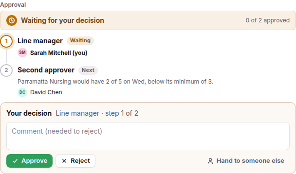" width="608">

<details><summary>The componentDefinition in the picture</summary>

```json
{
  "componentName": "solid-approval-chain",
  "name": "approvalChain",
  "label": "Approval",
  "noun": "request"
}
```

</details>

**componentDefinition** (`componentName: "solid-approval-chain"`, plus the [common options](#common-options)):

| Option | Type | What it does |
|---|---|---|
| `noun` | `string` | What is being approved, in the texts ("Save the request to send your decision"). Default "request". |
| `people` | `string \| Record<string, unknown>` | Elasticsearch request for the people a step can be delegated to. Default: active accounts. |
| `allowDelegate` | `boolean` | Offer delegation to the current step's approvers. Default true. |
| `commentOnReject` | `boolean` | A rejection needs a comment. Default true. |
| `approveLabel` | `string` | Button texts. Default "Approve" and "Reject". |
| `rejectLabel` | `string` | The reject button's text (default "Reject"). |
| `emptyText` | `string` | Shown while the chain has no steps. Default "Approvers are chosen when the <noun> is saved." |
| `hideLabel` | `boolean` | Hide the label. |

### `<solid-checklist>`

A check sheet (Daily Driver pre-start, service checks) answered Pass / Fail / N/A with comments, grouped by category, with progress and the sheet's result. Checks come from the definition or from a check sheet document the record points to (e.g. through its asset).

| | |
|---|---|
| Package | `@solidjs-components/checklist` 0.2.0 · [README](solidjs-components-shared/components/checklist/README.md) |
| Source | [solidjs-components-shared/components/checklist/src/main.tsx](solidjs-components-shared/components/checklist/src/main.tsx) · [Checklist.tsx](solidjs-components-shared/components/checklist/src/Checklist.tsx) (`ChecklistDefinition`) |
| Built bundle | `solidjs-components-shared/dist/solid-checklist/solid-checklist.js` |
| In fieldtec-web | `server/public/vendor/custom-component-modules/dist/solidjs-components/solid-checklist/solid-checklist.js` |

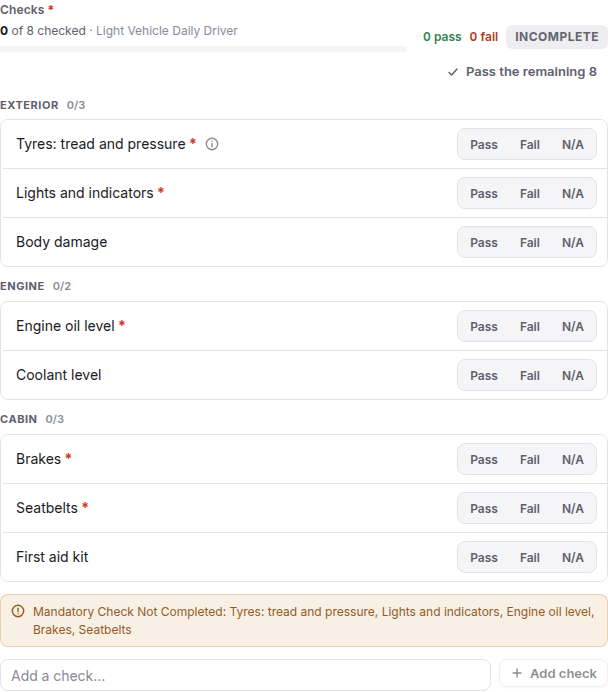" width="608">

<details><summary>The componentDefinition in the picture</summary>

```json
{
  "componentName": "solid-checklist",
  "name": "checksArr",
  "label": "Checks",
  "mandatory": true,
  "itemsFrom": {
    "field": "assetRel",
    "documentField": "checkSheetRel",
    "itemsField": "checkItems"
  },
  "allowAdd": true
}
```

</details>

**componentDefinition** (`componentName: "solid-checklist"`, plus the [common options](#common-options)):

| Option | Type | What it does |
|---|---|---|
| `mode` | `'answer' \| 'define'` | "answer" (default): answer the checks; "define": edit the checks themselves (a check sheet, a service plan's tasks). |
| `items` | `CheckDefinition[]` | The checks, when the definition lists them. |
| `itemsFrom` | `ItemsSource` | Or: read the checks from a check sheet document this record points to (e.g. through its asset). |
| `commentOnFail` | `boolean` | A failed check needs a comment (default true). |
| `failLabel` | `string` | The sheet's result when a check failed (default "Defects found"; e.g. "Hazards found"). |
| `allowNa` | `boolean` | Offer N/A (default true). |
| `allowAdd` | `boolean` | Let people add a one-off check (default false). |
| `answerLabels` | `{ pass?: string; fail?: string; na?: string }` | What the answers are called (default Pass, Fail, N/A): `{ "pass": "Done", "fail": "Blocked" }` for onboarding tasks. |
| `passLabel` | `string` | The sheet's result when every check is answered and none failed (default "Pass"). Display only: the stored outcome keeps "Pass". |
| `hideLabel` | `boolean` | Hide the label. |

### `<solid-comments>`

A document's comment thread with Markdown, replies, edits and votes, stored like sc-note-comment (SDMS notesCommentsArr).

| | |
|---|---|
| Package | `@solidjs-components/comments` 0.1.0 · [README](solidjs-components-shared/components/comments/README.md) |
| Source | [solidjs-components-shared/components/comments/src/main.tsx](solidjs-components-shared/components/comments/src/main.tsx) · [Comments.tsx](solidjs-components-shared/components/comments/src/Comments.tsx) (`CommentsDefinition`) |
| Built bundle | `solidjs-components-shared/dist/solid-comments/solid-comments.js` |
| In fieldtec-web | `server/public/vendor/custom-component-modules/dist/solidjs-components/solid-comments/solid-comments.js` |

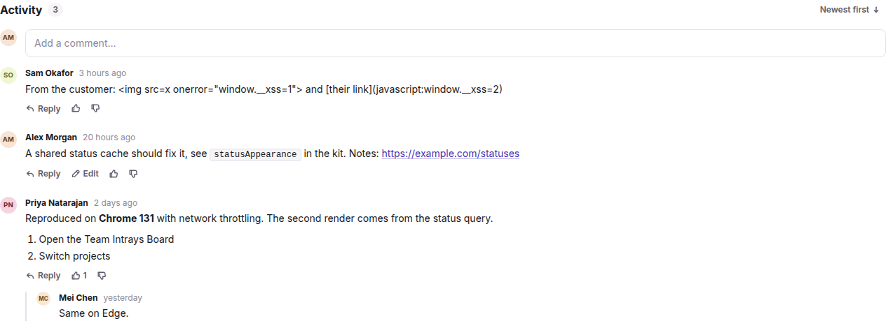" width="900">

<details><summary>The componentDefinition in the picture</summary>

```json
{
  "componentName": "solid-comments",
  "name": "notesCommentsArr",
  "label": "Activity",
  "fullWidth": true,
  "textEditor": "markdown"
}
```

</details>

**componentDefinition** (`componentName: "solid-comments"`, plus the [common options](#common-options)):

| Option | Type | What it does |
|---|---|---|
| `textEditor` | `string` | "markdown" (default) renders Markdown; any other value shows the text as typed. |
| `disableCommentFunction` | `boolean` | No replies under comments (sc-note-comment). |
| `disableVoteFunction` | `boolean` | No thumbs up / down (sc-note-comment). |
| `allowNoteEditingKeys` | `string[]` | Holders of these access keys with the Update right may edit anyone's comment (sc-note-comment). |
| `order` | `Order` | Initial order. Default "newest". |
| `placeholder` | `string` | Text shown while empty. |
| `hideLabel` | `boolean` | Hide the label. |

### `<solid-date-range>`

When something starts and ends, bound to two fields. Date and time (bookings, workshop jobs): quick durations, the duration shown and the time range rules. Days (leave, rosters): first and last day, half days, working days counted without weekends and public holidays, shown as a strip of days.

| | |
|---|---|
| Package | `@solidjs-components/date-range` 0.2.0 · [README](solidjs-components-shared/components/date-range/README.md) |
| Source | [solidjs-components-shared/components/date-range/src/main.tsx](solidjs-components-shared/components/date-range/src/main.tsx) · [DateRange.tsx](solidjs-components-shared/components/date-range/src/DateRange.tsx) (`DateRangeDefinition`) |
| Built bundle | `solidjs-components-shared/dist/solid-date-range/solid-date-range.js` |
| In fieldtec-web | `server/public/vendor/custom-component-modules/dist/solidjs-components/solid-date-range/solid-date-range.js` |

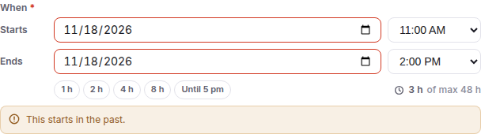" width="608">

<details><summary>The componentDefinition in the picture</summary>

```json
{
  "componentName": "solid-date-range",
  "name": "startDate",
  "label": "When",
  "endField": "endDate",
  "mandatory": true,
  "maxHoursFrom": "assetRel.0.maxBookingHours",
  "maxText": "This asset can be booked for at most {max} hours at a time."
}
```

</details>

**componentDefinition** (`componentName: "solid-date-range"`, plus the [common options](#common-options)):

| Option | Type | What it does |
|---|---|---|
| `mode` | `'datetime' \| 'days'` | "datetime" (default): a start and end date and time; "days": a first and last day, counted in working days. Read once. |
| `endField` (required) | `string` | Field the end is written to; this element's own field holds the start. |
| `startLabel` | `string` | Label of the start (default "Starts"). |
| `endLabel` | `string` | Label of the end (default "Ends"). |
| `noun` | `string` | What the range is of, in the messages: "The booking must end after it starts" (default "booking", or "leave" for days). |
| `warnPast` | `boolean` | Warn when a new range starts in the past (default true). |
| `hideLabel` | `boolean` | Hide the label. |
| `stepMinutes` | `number` | Minutes between the times offered (default 30). |
| `presets` | `number[]` | Quick durations offered: hours (default [1, 2, 4, 8]); working days in days mode (default [1, 2, 5, 10]). |
| `minMinutes` | `number` | Shortest range allowed, in minutes (default 15). |
| `maxHours` | `number` | Longest range allowed, in hours. |
| `maxHoursFrom` | `string` | Where else the longest range comes from: another field's path, e.g. "assetRel.0.maxBookingHours". |
| `maxText` | `string` | The message when the range is too long; `{max}` receives the hours. |
| `defaultHours` | `number` | Length of a new range when only the start is set, in hours (default 2). |
| `timeZone` | `string` | Time zone the days are in (the company's, e.g. "Australia/Sydney"). Default: the browser's. |
| `holidays` | `(string \| Holiday)[]` | Public holidays: "YYYY-MM-DD", or `{ date, name }`. Not counted as working days. |
| `workDays` | `number[]` | Days of the week that are worked, 0 (Sunday) to 6 (Saturday). Default Monday to Friday. |
| `startHalfField` | `string` | Offer half days: "Starts at midday" and "Ends at midday", written to these boolean fields. |
| `endHalfField` | `string` | Boolean field: the last day ends at midday. |
| `daysField` | `string` | Field the working-day count is written to (e.g. "daysNum"), so other fields and rules can use it. |

### `<solid-image-pins>`

Numbered pins on a built-in body figure (front and back views made of named regions: where someone was hurt) or on any image (a floor plan, a drawing with defects). Each pin stores its position as fractions of the view, the region under it, a kind (its colour) and a note.

| | |
|---|---|
| Package | `@solidjs-components/image-pins` 0.1.0 · [README](solidjs-components-shared/components/image-pins/README.md) |
| Source | [solidjs-components-shared/components/image-pins/src/main.tsx](solidjs-components-shared/components/image-pins/src/main.tsx) · [ImagePins.tsx](solidjs-components-shared/components/image-pins/src/ImagePins.tsx) (`ImagePinsDefinition`) |
| Built bundle | `solidjs-components-shared/dist/solid-image-pins/solid-image-pins.js` |
| In fieldtec-web | `server/public/vendor/custom-component-modules/dist/solidjs-components/solid-image-pins/solid-image-pins.js` |

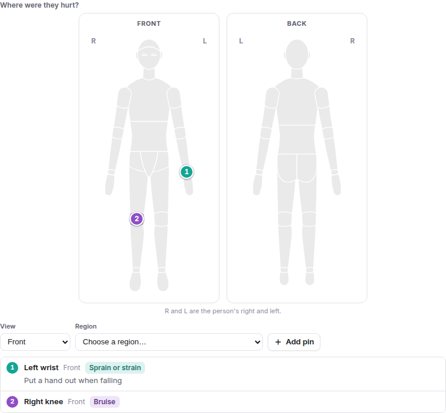" width="760">

<details><summary>The componentDefinition in the picture</summary>

```json
{
  "componentName": "solid-image-pins",
  "name": "injuryPinsArr",
  "label": "Where were they hurt?",
  "fullWidth": true
}
```

</details>

**componentDefinition** (`componentName: "solid-image-pins"`, plus the [common options](#common-options)):

| Option | Type | What it does |
|---|---|---|
| `figure` | `'body'` | Built-in figure: "body" (front and back views with named regions). The default without `image` or `views`. |
| `image` | `string` | A custom image instead of a figure. |
| `views` | `PinViewDefinition[]` | Several custom images, side by side. |
| `kinds` | `(PinKind \| string)[]` | Pin categories: `[{ name, color }]` or names. Default: injury kinds for the body figure, none otherwise. |
| `maxPins` | `number` | Most pins the field takes (default 30). |
| `readOnly` | `boolean` | Show the value without letting it change. |
| `hideLabel` | `boolean` | Hide the label. |

### `<solid-line-items>`

Costs line by line (a work order's parts and labour, a purchase's goods, services and freight): kinds, a catalogue to pick from, quantities and unit costs, totals per kind, subtotal, tax and total from the kit's lineTotals.

| | |
|---|---|
| Package | `@solidjs-components/line-items` 0.2.0 · [README](solidjs-components-shared/components/line-items/README.md) |
| Source | [solidjs-components-shared/components/line-items/src/main.tsx](solidjs-components-shared/components/line-items/src/main.tsx) · [LineItems.tsx](solidjs-components-shared/components/line-items/src/LineItems.tsx) (`LineItemsDefinition`) |
| Built bundle | `solidjs-components-shared/dist/solid-line-items/solid-line-items.js` |
| In fieldtec-web | `server/public/vendor/custom-component-modules/dist/solidjs-components/solid-line-items/solid-line-items.js` |

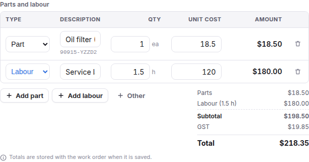" width="608">

<details><summary>The componentDefinition in the picture</summary>

```json
{
  "componentName": "solid-line-items",
  "name": "lineItemsArr",
  "label": "Parts and labour",
  "labourRate": 120,
  "materialFilter": "{'sort':[{'systemHeader.summaryName':'asc'}],'query':{'bool':{'filter':[{'term':{'appTags':'material'}}]}}}"
}
```

</details>

**componentDefinition** (`componentName: "solid-line-items"`, plus the [common options](#common-options)):

| Option | Type | What it does |
|---|---|---|
| `currency` | `string` | ISO currency (default AUD). |
| `taxRate` | `number` | Tax on the subtotal (default 0.1). |
| `taxLabel` | `string` | Default "GST". |
| `labourRate` | `number` | Hourly rate new labour lines start at (default: none, the cost is left to fill in). Work order kinds only. |
| `kinds` | `LineKind[]` | The kinds of line. Default: a work order's part, labour and other. |
| `materialFilter` | `string \| Record<string, unknown>` | A catalogue to pick lines from (materials, supplier items): any related-document filter. |
| `materialFields` | `{ partNo?: string; unitCost?: string; unit?: string; stock?: string }` | Fields on catalogue documents (defaults: partNo, unitCost, unit, qtyAvailable). |
| `catalogKind` | `string` | The kind a picked catalogue line gets (default "part"), and the pick button's text (default "Add part"). |
| `catalogLabel` | `string` | Text of the button that picks from the catalogue (default "Add part"). |
| `catalogNoun` | `string` | What the catalogue holds, in its search ("parts"; "items"). |
| `costLabel` | `string` | Column heading of the unit cost (default "Unit cost"). |
| `emptyText` | `string` | Shown while there are no lines (default "No parts or labour yet."). |
| `noteText` | `string` | Under the totals while editing (default "Totals are stored with the work order when it is saved."). |
| `hideLabel` | `boolean` | Hide the label. |

### `<solid-lookup-picker>`

Single or multi pick from lookup documents (type, priority, severity, labels...) with icons.

| | |
|---|---|
| Package | `@solidjs-components/lookup-picker` 0.1.0 · [README](solidjs-components-shared/components/lookup-picker/README.md) |
| Source | [solidjs-components-shared/components/lookup-picker/src/main.tsx](solidjs-components-shared/components/lookup-picker/src/main.tsx) · [LookupPicker.tsx](solidjs-components-shared/components/lookup-picker/src/LookupPicker.tsx) (`LookupDefinition`) |
| Built bundle | `solidjs-components-shared/dist/solid-lookup-picker/solid-lookup-picker.js` |
| In fieldtec-web | `server/public/vendor/custom-component-modules/dist/solidjs-components/solid-lookup-picker/solid-lookup-picker.js` |

" width="900">

<details><summary>The componentDefinition in the picture</summary>

```json
{
  "componentName": "solid-lookup-picker",
  "name": "priorityRel",
  "label": "Priority",
  "singleSelection": true,
  "showDropDown": true,
  "filter": "{'sort':[{'indexNum':'asc'},{'systemHeader.summaryName':'asc'}],'query':{'bool':{'filter':[{'term':{'systemHeader.systemType':'document'}},{'term':{'appTags':'priority'}},{'term':{'appTags':'sdms'}}],'must_not':[{'term':{'inactiveBool':true}}]}}}",
  "relatedFields": {
    "projectRel": "projectRel",
    "isGlobalDefaultBool": "isGlobalDefaultBool",
    "indexNum": "indexNum"
  }
}
```

</details>

**componentDefinition** (`componentName: "solid-lookup-picker"`, plus the [common options](#common-options)):

| Option | Type | What it does |
|---|---|---|
| `iconSet` | `IconSet \| 'auto'` | Icons next to values: issue-type tiles, priority arrows, or none. Default: guessed from the field name. |
| `icons` | `Record<string, IconOverride>` | Per-value icon or colour, by name: `{ "Bug": { "icon": "bug", "color": "#e5484d" } }`. |
| `colorField` | `string` | Field on lookup documents holding a CSS colour (also add it to relatedFields to colour stored values). |
| `iconKindField` | `string` | Field on the documents naming each value's icon kind ("van", "forklift"…), when names don't say it (asset "U-301 · Toyota HiLux" is a ute). Add it to relatedFields so stored values keep it. |
| `emptyLabel` | `string` | Text for an empty single value. Default "None". |
| `singleSelection` | `boolean` | Single value instead of a list (sc-related-document default is a list). _(RelatedPickerDefinition)_ |
| `showDropDown` | `boolean` | When false, nothing is listed until the user types (large lookups such as accounts). _(RelatedPickerDefinition)_ |
| `hideLabel` | `boolean` | Hide the label. _(RelatedPickerDefinition)_ |

### `<solid-map>`

OpenLayers map of Formbird documents. Layers mode shows live searches (assets by type and hire status, sites with their boundaries) with popups and actions; point and area modes edit a document's location or boundary. Uses the page's openlayers-shared (global OL).

| | |
|---|---|
| Package | `@solidjs-components/map` 0.1.0 · [README](solidjs-components-shared/components/map/README.md) |
| Source | [solidjs-components-shared/components/map/src/main.tsx](solidjs-components-shared/components/map/src/main.tsx) · [MapElement.tsx](solidjs-components-shared/components/map/src/MapElement.tsx) (`MapDefinition`) |
| Built bundle | `solidjs-components-shared/dist/solid-map/solid-map.js` |
| In fieldtec-web | `server/public/vendor/custom-component-modules/dist/solidjs-components/solid-map/solid-map.js` |
| Vendor libraries | `openlayers-shared` |

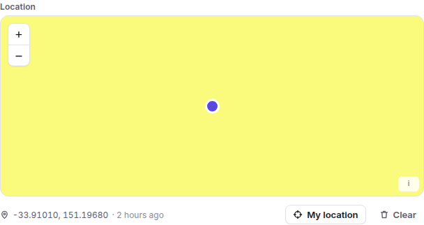" width="608">

<details><summary>The componentDefinition in the picture</summary>

```json
{
  "componentName": "solid-map",
  "name": "locationGeo",
  "label": "Location",
  "mode": "point",
  "height": "260px"
}
```

</details>

**componentDefinition** (`componentName: "solid-map"`, plus the [common options](#common-options)):

| Option | Type | What it does |
|---|---|---|
| `mode` | `'layers' \| 'point' \| 'area'` | "layers" (default): show documents; "point": edit this field's point; "area": edit this field's boundary. |
| `layers` | `MapLayer[]` | Layers mode: the searches drawn on the map (assets, sites…), with their popups and actions. |
| `height` | `string` | CSS height (default 440px, or 320px when editing). |
| `center` | `LonLat` | [lon, lat] when there is nothing to fit to (default Sydney). |
| `zoom` | `number` | Zoom when there is nothing to fit to (default 11 for layers, 15 for a point or area). |
| `tileUrl` | `string` | XYZ tile URL (default OpenStreetMap) and its attribution. |
| `tileAttribution` | `string` | Attribution shown for `tileUrl`. |
| `showList` | `boolean` | Show the list of features beside the map (layers mode; default true when wide). |
| `hideLabel` | `boolean` | Hide the label. |

### `<solid-photo-capture>`

Photos (or, with allowFiles, any files) on a record, taken or uploaded, downscaled, captioned, in a gallery with a lightbox; or, with layout "list", documents as rows with a type each (quote, invoice) and PDFs previewed in the lightbox.

| | |
|---|---|
| Package | `@solidjs-components/photo-capture` 0.2.0 · [README](solidjs-components-shared/components/photo-capture/README.md) |
| Source | [solidjs-components-shared/components/photo-capture/src/main.tsx](solidjs-components-shared/components/photo-capture/src/main.tsx) · [PhotoCapture.tsx](solidjs-components-shared/components/photo-capture/src/PhotoCapture.tsx) (`PhotoCaptureDefinition`) |
| Built bundle | `solidjs-components-shared/dist/solid-photo-capture/solid-photo-capture.js` |
| In fieldtec-web | `server/public/vendor/custom-component-modules/dist/solidjs-components/solid-photo-capture/solid-photo-capture.js` |

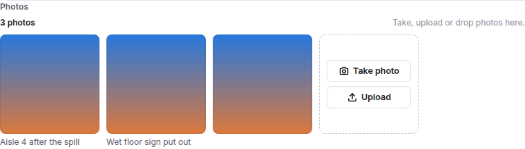" width="760">

<details><summary>The componentDefinition in the picture</summary>

```json
{
  "componentName": "solid-photo-capture",
  "name": "photosArr",
  "label": "Photos",
  "fullWidth": true
}
```

</details>

**componentDefinition** (`componentName: "solid-photo-capture"`, plus the [common options](#common-options)):

| Option | Type | What it does |
|---|---|---|
| `mode` | `'edit' \| 'view'` | "edit" (default) adds, captions and removes photos; "view" only shows them. |
| `maxPhotos` | `number` | Most photos (and files) the field takes (default 20). |
| `accept` | `string` | What Upload and drag-and-drop take, as `<input accept>` (default "image/*", or anything with `allowFiles`). |
| `allowFiles` | `boolean` | Take other files too (PDFs, documents); they show as file tiles. |
| `captions` | `boolean` | Show and edit captions (default true). |
| `capture` | `'environment' \| 'user' \| false \| ''` | Camera for "Take photo": "environment" (default, the back camera), "user" (the front one), or false for none. |
| `maxDimension` | `number` | Photos longer than this on either side are scaled down before upload (default 1920; 0 keeps originals). |
| `layout` | `'grid' \| 'list'` | "grid" (default): photo thumbnails; "list": documents as rows (attachments: quotes, invoices). |
| `kinds` | `Array<string \| { value: string; label?: string }>` | Document types to choose from for each file ("Quote", "Invoice"), stored as `kind`. |
| `defaultKind` | `string` | The type a new file gets (default: the first of `kinds`). |
| `hideLabel` | `boolean` | Hide the label. |

### `<solid-record-key>`

A record's reference number (TRK-12, REQ-0041) with its type icon and a copy-link button. Display only; the server assigns the number.

| | |
|---|---|
| Package | `@solidjs-components/record-key` 0.1.0 · [README](solidjs-components-shared/components/record-key/README.md) |
| Source | [solidjs-components-shared/components/record-key/src/main.tsx](solidjs-components-shared/components/record-key/src/main.tsx) · [RecordKey.tsx](solidjs-components-shared/components/record-key/src/RecordKey.tsx) (`RecordKeyDefinition`) |
| Built bundle | `solidjs-components-shared/dist/solid-record-key/solid-record-key.js` |
| In fieldtec-web | `server/public/vendor/custom-component-modules/dist/solidjs-components/solid-record-key/solid-record-key.js` |

" width="900">

<details><summary>The componentDefinition in the picture</summary>

```json
{
  "componentName": "solid-record-key",
  "name": "itemRef",
  "label": "Key",
  "type": "Reference No",
  "counterDocumentId": "8fa2ce09-89c3-4e83-87ec-43b985c8ebb4",
  "counterFieldName": "itemReferenceCounter",
  "format": "#",
  "prefix": "SDMS",
  "enabled": false,
  "newText": "New issue"
}
```

</details>

**componentDefinition** (`componentName: "solid-record-key"`, plus the [common options](#common-options)):

| Option | Type | What it does |
|---|---|---|
| `prefix` | `string` | Key shown before a bare number ("SDMS" + "482" → "SDMS-482"). Supports Handlebars. |
| `copy` | `'link' \| 'key' \| 'none'` | What the copy button copies: the record's URL (default), the key, or no button. |
| `typeField` | `string` | Related-document field holding the record's type, shown as an icon. Default "typeRel"; "" hides it. |
| `iconSet` | `IconSet` | Icon family for the type: "type" (issue types, default), "asset", "work" or "priority". |
| `newText` | `string` | Shown until the first save assigns the number. Default "New". |
| `hideLabel` | `boolean` | Hide the label. |

### `<solid-resource-schedule>`

People (or assets) by day: each row's records as bars across the days (leave, jobs, shifts), grouped by team with how many are left on each day against a minimum, weekends and public holidays shaded, figures per row (leave balances), and drag across free days to start a new record.

| | |
|---|---|
| Package | `@solidjs-components/resource-schedule` 0.1.0 · [README](solidjs-components-shared/components/resource-schedule/README.md) |
| Source | [solidjs-components-shared/components/resource-schedule/src/main.tsx](solidjs-components-shared/components/resource-schedule/src/main.tsx) · [ResourceSchedule.tsx](solidjs-components-shared/components/resource-schedule/src/ResourceSchedule.tsx) (`ResourceScheduleDefinition`) |
| Built bundle | `solidjs-components-shared/dist/solid-resource-schedule/solid-resource-schedule.js` |
| In fieldtec-web | `server/public/vendor/custom-component-modules/dist/solidjs-components/solid-resource-schedule/solid-resource-schedule.js` |

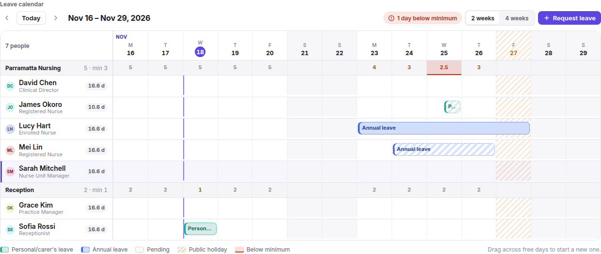" width="900">

<details><summary>The componentDefinition in the picture</summary>

```json
{
  "componentName": "solid-resource-schedule",
  "name": "calendar",
  "label": "Leave calendar",
  "disableSave": true,
  "rowFilter": "{'query':{'bool':{'filter':[{'term':{'systemHeader.systemType':'account'}}]}},'sort':[{'teamRel.indexNum':'asc'},{'systemHeader.summaryName':'asc'}]}",
  "rowDetailField": "jobTitle",
  "groupField": "teamRel.name",
  "groupMinField": "teamRel.minOnDutyNum",
  "rowFigures": [
    {
      "label": "Annual leave available",
      "path": "annualAvailableNum",
      "unit": "d",
      "warnBelow": 0
    }
  ],
  "filter": "{'query':{'bool':{'filter':[{'term':{'appTags':'leave'}},{'terms':{'leaveStatusRel.name':['Pending','Approved']}}]}}}",
  "rowField": "employeeRel.documentId",
  "startField": "startDate",
  "endField": "endDate",
  "startHalfField": "startHalfBool",
  "endHalfField": "endHalfBool",
  "labelField": "leaveTypeRel.name",
  "colorField": "leaveTypeRel.color",
  "statusField": "leaveStatusRel.name",
  "tentativeStatuses": [
    "Pending"
  ],
  "timeZone": "UTC",
  "holidays": [
    {
      "date": "2026-11-27",
      "name": "Show Day"
    }
  ],
  "days": 14,
  "views": [
    14,
    28
  ],
  "templateId": "template-leave",
  "newLabel": "Request leave",
  "createFor": "me",
  "rowValueFields": {
    "email": "email",
    "teamRel": "teamRel"
  }
}
```

</details>

**componentDefinition** (`componentName: "solid-resource-schedule"`, plus the [common options](#common-options)):

| Option | Type | What it does |
|---|---|---|
| `rowFilter` | `string \| Record<string, unknown>` | Elasticsearch request for the rows (people, assets). Default: active accounts, by name. |
| `rowLabelField` | `string` | Row name and second line (dot paths). Default the summary name and nothing. |
| `rowDetailField` | `string` | Second line under a row's name (dot path). |
| `groupField` | `string` | Group rows by this path ("teamRel.name"); each group shows who is left each day. |
| `groupMinField` | `string` | The group's minimum on a work day, read from its rows ("teamRel.minOnDutyNum"). |
| `rowFigures` | `RowFigure[]` | Figures beside each name. |
| `filter` | `string \| Record<string, unknown>` | Elasticsearch request for the records; the element adds the visible days. |
| `rowField` | `string` | Path on a record to its row's documentId. Default "employeeRel.documentId". |
| `startField` | `string` | A record's first and last day (instants read in `timeZone`). Default "startDate" / "endDate". |
| `endField` | `string` | A record's last day (default "endDate"). |
| `startHalfField` | `string` | Boolean fields: the record starts / ends at midday. |
| `endHalfField` | `string` | Boolean field: the record ends at midday. |
| `labelField` | `string` | What a bar says and its colour (dot paths; arrays are read through). |
| `colorField` | `string` | A bar's colour (default: a colour from its label). |
| `statusField` | `string` | A record's status (dot path to its name), in the tooltip. |
| `tentativeStatuses` | `string[]` | Statuses drawn hatched: not confirmed yet. |
| `countTentative` | `boolean` | Count tentative records when working out who is left. Default true: a pending request is a clash in waiting. |
| `timeZone` | `string` | Time zone the days are in. Default the browser's. |
| `holidays` | `(string \| Holiday)[]` | Public holidays: shaded, and not counted as days off ("YYYY-MM-DD" or `{ date, name }`). |
| `workDays` | `number[]` | Days of the week that are worked, 0 (Sunday) to 6. Default Monday to Friday. |
| `days` | `number` | Days shown, and the lengths offered. Default 14, [14, 28]. |
| `views` | `number[]` | The lengths, in days, offered as views (default [14, 28]). |
| `templateId` | `string` | Template of new records: drag across free days in a row to start one. |
| `createFor` | `'me' \| 'anyone'` | Who can start a new record on their row: "me" (default) or "anyone" (managers). |
| `newRowField` | `string` | Field of the new record that holds the row. Default: the first part of `rowField` ("employeeRel"). |
| `rowValueFields` | `Record<string, string>` | What the new record keeps of its row besides documentId and name: `{ storedKey: 'path' }`. |
| `newLabel` | `string` | Text of the toolbar button and the drag confirmation. Default "New". |
| `openIn` | `OpenMode` | Where a record opens: "route" (default), "modal" or "newTab". |
| `hideLabel` | `boolean` | Hide the label. |

### `<solid-stat-tiles>`

Dashboard tiles, each a live Elasticsearch count (assets on hire, urgent defects, services due…) with a tone, a hint and a link to the list behind it.

| | |
|---|---|
| Package | `@solidjs-components/stat-tiles` 0.1.0 · [README](solidjs-components-shared/components/stat-tiles/README.md) |
| Source | [solidjs-components-shared/components/stat-tiles/src/main.tsx](solidjs-components-shared/components/stat-tiles/src/main.tsx) · [StatTiles.tsx](solidjs-components-shared/components/stat-tiles/src/StatTiles.tsx) (`StatTilesDefinition`) |
| Built bundle | `solidjs-components-shared/dist/solid-stat-tiles/solid-stat-tiles.js` |
| In fieldtec-web | `server/public/vendor/custom-component-modules/dist/solidjs-components/solid-stat-tiles/solid-stat-tiles.js` |

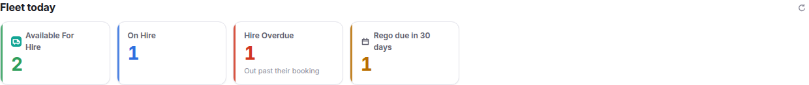" width="900">

<details><summary>The componentDefinition in the picture</summary>

```json
{
  "componentName": "solid-stat-tiles",
  "name": "fleetTiles",
  "label": "Fleet today",
  "disableSave": true,
  "tiles": [
    {
      "label": "Available For Hire",
      "tone": "good",
      "filter": "{'query':{'bool':{'filter':[{'term':{'appTags':'asset'}},{'term':{'hireStatusRel.name':'Available For Hire'}}]}}}",
      "link": "page-assets",
      "icon": "asset:Panel Van"
    },
    {
      "label": "On Hire",
      "tone": "info",
      "filter": "{'query':{'bool':{'filter':[{'term':{'appTags':'asset'}},{'term':{'hireStatusRel.name':'On Hire'}}]}}}"
    },
    {
      "label": "Hire Overdue",
      "tone": "bad",
      "zeroTone": "good",
      "filter": "{'query':{'bool':{'filter':[{'term':{'appTags':'booking'}},{'term':{'bookingStatusRel.name':'Hire Commenced'}},{'range':{'endDate':{'lt':'now'}}}]}}}",
      "hint": "Out past their booking"
    },
    {
      "label": "Rego due in 30 days",
      "tone": "warn",
      "icon": "calendar",
      "filter": "{'query':{'bool':{'filter':[{'term':{'appTags':'asset'}},{'range':{'regDueDate':{'lte':'now+30d/d'}}}]}}}"
    }
  ]
}
```

</details>

**componentDefinition** (`componentName: "solid-stat-tiles"`, plus the [common options](#common-options)):

| Option | Type | What it does |
|---|---|---|
| `tiles` | `StatTile[]` | The tiles: each an Elasticsearch count with its label, tone, hint and link. |
| `refreshSeconds` | `number` | Count again every N seconds (0: only on load, on save and on refresh). |
| `hideLabel` | `boolean` | Hide the label. |

### `<solid-status>`

A workflow status as a coloured lozenge button offering only the allowed transitions, with an optional second step (resolution, cancellation reason) and transitions guarded by access keys.

| | |
|---|---|
| Package | `@solidjs-components/status` 0.1.0 · [README](solidjs-components-shared/components/status/README.md) |
| Source | [solidjs-components-shared/components/status/src/main.tsx](solidjs-components-shared/components/status/src/main.tsx) · [Status.tsx](solidjs-components-shared/components/status/src/Status.tsx) (`StatusDefinition`) |
| Built bundle | `solidjs-components-shared/dist/solid-status/solid-status.js` |
| In fieldtec-web | `server/public/vendor/custom-component-modules/dist/solidjs-components/solid-status/solid-status.js` |

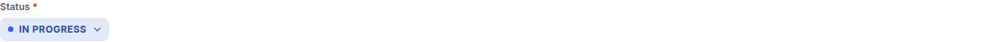" width="900">

<details><summary>The componentDefinition in the picture</summary>

```json
{
  "componentName": "solid-status",
  "name": "statusRel",
  "label": "Status",
  "mandatory": true,
  "filter": "{'sort':[{'indexNum':'asc'},{'systemHeader.summaryName':'asc'}],'query':{'bool':{'filter':[{'term':{'systemHeader.systemType':'document'}},{'term':{'appTags':'status'}},{'term':{'appTags':'sdms'}}],'must_not':[{'term':{'inactiveBool':true}}]}}}",
  "relatedFields": {
    "projectRel": "projectRel",
    "isGlobalDefaultBool": "isGlobalDefaultBool",
    "disableItemBool": "disableItemBool",
    "indexNum": "indexNum"
  },
  "transitions": {
    "New": [
      "Acknowledged",
      "Assigned",
      "In Progress",
      "Won't Fix"
    ],
    "Acknowledged": [
      "Assigned",
      "In Progress",
      "Won't Fix"
    ],
    "Assigned": [
      "In Progress",
      "Acknowledged"
    ],
    "In Progress": [
      "In Review",
      "Assigned",
      "Resolved"
    ],
    "In Review": [
      "In Progress",
      "Testing",
      "Resolved"
    ],
    "Testing": [
      "In Progress",
      "Resolved"
    ],
    "Resolved": [
      "Closed",
      "In Progress"
    ],
    "Closed": [
      "In Progress"
    ],
    "Won't Fix": [
      "New"
    ]
  },
  "resolution": {
    "fieldName": "resolutionRel",
    "label": "Resolution",
    "requiredFor": [
      "done"
    ],
    "filter": "{'sort':[{'indexNum':'asc'},{'systemHeader.summaryName':'asc'}],'query':{'bool':{'filter':[{'term':{'systemHeader.systemType':'document'}},{'term':{'appTags':'resolution'}},{'term':{'appTags':'sdms'}}],'must_not':[{'term':{'inactiveBool':true}}]}}}",
    "relatedFields": {
      "projectRel": "projectRel",
      "isGlobalDefaultBool": "isGlobalDefaultBool"
    }
  }
}
```

</details>

**componentDefinition** (`componentName: "solid-status"`, plus the [common options](#common-options)):

| Option | Type | What it does |
|---|---|---|
| `transitions` | `Record<string, string[]>` | Allowed moves by status name: `{ "New": ["In Progress"], "*": [...] }`. Default: any status. |
| `transitionsField` | `string` | Field on status documents listing the next statuses (`[{ documentId, name }]`); overrides `transitions`. |
| `transitionKeys` | `Record<string, string \| string[]>` | Moves only some people may make: target status name → access key id(s) the user needs (with the Update right), e.g. `{ "Closed": ["<supervisor key>"] }`. Others don't see those targets. Enforce the same rule in a PreSaveServer ruleset: this only shapes the picker. |
| `resolution` | `ResolutionStep` | A second step when moving into a done status: choose a resolution (or a cancellation reason). |
| `hideLabel` | `boolean` | Hide the label. |
| `colors` | `Record<string, string>` | Colour overrides by status name. _(StatusAppearanceOptions)_ |
| `categories` | `Record<string, StatusCategory>` | Category overrides by status name. _(StatusAppearanceOptions)_ |
| `colorField` | `string` | Field on status documents holding a CSS colour. Default "color" (SDMS Status has one). _(StatusAppearanceOptions)_ |
| `categoryField` | `string` | Field on status documents holding "todo" \| "inprogress" \| "done". Default "statusCategory". _(StatusAppearanceOptions)_ |

### `<solid-table>`

Documents from an Elasticsearch filter in a table, with typed columns (key, status, priority, people, labels, dates), server-side sorting and paging, search and CSV export. Accepts sc-datatables' main options.

| | |
|---|---|
| Package | `@solidjs-components/table` 0.1.0 · [README](solidjs-components-shared/components/table/README.md) |
| Source | [solidjs-components-shared/components/table/src/main.tsx](solidjs-components-shared/components/table/src/main.tsx) · [Table.tsx](solidjs-components-shared/components/table/src/Table.tsx) (`TableDefinition`) |
| Built bundle | `solidjs-components-shared/dist/solid-table/solid-table.js` |
| In fieldtec-web | `server/public/vendor/custom-component-modules/dist/solidjs-components/solid-table/solid-table.js` |

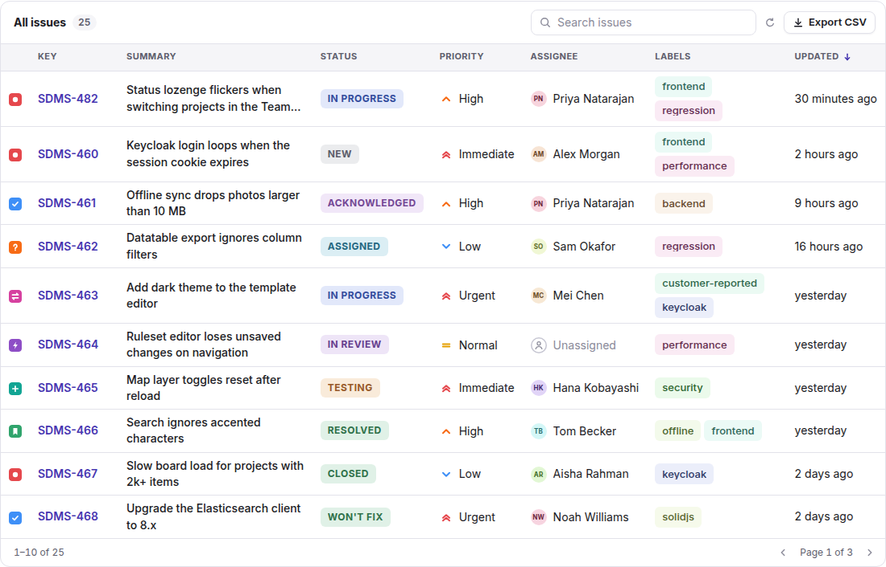" width="900">

<details><summary>The componentDefinition in the picture</summary>

```json
{
  "componentName": "solid-table",
  "name": "allItemsDt",
  "label": "All issues",
  "fullWidth": true,
  "disableSave": true,
  "rowsPerPage": 10,
  "showSearch": true,
  "searchPlaceholder": "Search issues",
  "showReload": true,
  "exportTypes": [
    "CSV"
  ],
  "filter": "{'query':{'bool':{'filter':[{'term':{'systemHeader.systemType':'document'}},{'term':{'appTags':'item'}},{'term':{'appTags':'sdms'}}]}}}",
  "searchBoxFilter": "{'bool':{'should':[{'wildcard':{'systemHeader.summaryName.lcase':{'value':'*{{{search}}}*','case_insensitive':true}}},{'wildcard':{'summary.lcase':{'value':'*{{{search}}}*','case_insensitive':true}}},{'wildcard':{'description.lcase':{'value':'*{{{search}}}*','case_insensitive':true}}},{'wildcard':{'notesCommentsArr.detail.lcase':{'value':'*{{{search}}}*','case_insensitive':true}}}],'minimum_should_match':1}}",
  "statusFilter": "{'sort':[{'indexNum':'asc'}],'query':{'bool':{'filter':[{'term':{'systemHeader.systemType':'document'}},{'term':{'appTags':'status'}},{'term':{'appTags':'sdms'}}]}}}",
  "gridColumns": [
    {
      "displayName": "Type",
      "field": "typeRel",
      "type": "issueType",
      "iconOnly": true
    },
    {
      "displayName": "Key",
      "field": "systemHeader.summaryName",
      "type": "key",
      "width": "110px"
    },
    {
      "displayName": "Summary",
      "field": "summary",
      "link": true
    },
    {
      "displayName": "Status",
      "field": "statusRel",
      "type": "status"
    },
    {
      "displayName": "Priority",
      "field": "priorityRel",
      "type": "priority",
      "responsive": {
        "xs": 0,
        "sm": 0
      }
    },
    {
      "displayName": "Assignee",
      "field": "assigneeRel",
      "type": "user",
      "responsive": {
        "xs": 0
      }
    },
    {
      "displayName": "Labels",
      "field": "tagsRel",
      "type": "labels",
      "responsive": {
        "xs": 0,
        "sm": 0,
        "md": 0
      }
    },
    {
      "displayName": "Updated",
      "field": "updatedDate",
      "type": "date",
      "sort": {
        "direction": "desc",
        "precedence": 1
      },
      "responsive": {
        "xs": 0
      }
    }
  ]
}
```

</details>

**componentDefinition** (`componentName: "solid-table"`, plus the [common options](#common-options)):

| Option | Type | What it does |
|---|---|---|
| `gridColumns` | `TableColumn[]` | Columns, in sc-datatables' format plus the types in the README. |
| `rowsPerPage` | `number` | Rows per page. Default 10. |
| `showSearch` | `boolean` | Show a search box. |
| `searchBoxFilter` | `string` | Clause added for the search box text (sc-datatables), `{{{search}}}` receives the text. Default: a summary-name wildcard. |
| `searchPlaceholder` | `string` | Text shown in the empty search box. |
| `exportTypes` | `string[]` | `["CSV"]` adds an Export button. |
| `exportLimit` | `number` | Most rows an export writes. Default 2000, at most 10000. |
| `showReload` | `boolean` | Show a reload button. |
| `emptyText` | `string` | Text when nothing matches. |
| `openIn` | `OpenMode` | Where a clicked row opens: "route" (default), "modal" or "newTab". |
| `rowClick` | `boolean` | `false`: rows aren't clickable (links in cells still are). |
| `statusFilter` | `string \| Record<string, unknown>` | Filter listing status documents, so status columns use their colours. |
| `hideLabel` | `boolean` | Hide the label. |

### `<solid-user-picker>`

Assignee / reporter / watchers picker with avatars and 'Assign to me'.

| | |
|---|---|
| Package | `@solidjs-components/user-picker` 0.1.0 · [README](solidjs-components-shared/components/user-picker/README.md) |
| Source | [solidjs-components-shared/components/user-picker/src/main.tsx](solidjs-components-shared/components/user-picker/src/main.tsx) · [UserPicker.tsx](solidjs-components-shared/components/user-picker/src/UserPicker.tsx) (`UserDefinition`) |
| Built bundle | `solidjs-components-shared/dist/solid-user-picker/solid-user-picker.js` |
| In fieldtec-web | `server/public/vendor/custom-component-modules/dist/solidjs-components/solid-user-picker/solid-user-picker.js` |

" width="900">

<details><summary>The componentDefinition in the picture</summary>

```json
{
  "componentName": "solid-user-picker",
  "name": "assigneeRel",
  "label": "Assignee",
  "singleSelection": true,
  "showDropDown": true,
  "relatedFields": {
    "email": "email"
  },
  "filter": "{'sort':[{'systemHeader.summaryName':'asc'}],'query':{'bool':{'filter':[{'term':{'systemHeader.systemType':'account'}},{'term':{'appRel.documentId':'db625088-19bf-4eb6-9783-5f0f11c5aede'}},{'term':{'sdmsProjectRel.documentId':'{{document.projectRel.0.documentId}}'}}],'must_not':[{'term':{'inactiveBool':true}}]}}}"
}
```

</details>

**componentDefinition** (`componentName: "solid-user-picker"`, plus the [common options](#common-options)):

| Option | Type | What it does |
|---|---|---|
| `emailField` | `string` | Account field shown under each name. Default "email". |
| `avatarField` | `string` | Account field holding a photo URL; initials are shown without one. |
| `showAssignToMe` | `boolean` | Offer "Assign to me" / "Add me". Default true. |
| `emptyLabel` | `string` | Text for an empty single value. Default "Unassigned". |
| `singleSelection` | `boolean` | Single value instead of a list (sc-related-document default is a list). _(RelatedPickerDefinition)_ |
| `showDropDown` | `boolean` | When false, nothing is listed until the user types (large lookups such as accounts). _(RelatedPickerDefinition)_ |
| `hideLabel` | `boolean` | Hide the label. _(RelatedPickerDefinition)_ |

## Issue tracker (internal)

[`solidjs-components-internal`](solidjs-components-internal/README.md)

### `<solid-issue-summary>`

Inline-editable issue title.

| | |
|---|---|
| Package | `@solidjs-components/issue-summary` 0.1.0 · [README](solidjs-components-internal/components/issue-summary/README.md) |
| Source | [solidjs-components-internal/components/issue-summary/src/main.tsx](solidjs-components-internal/components/issue-summary/src/main.tsx) · [IssueSummary.tsx](solidjs-components-internal/components/issue-summary/src/IssueSummary.tsx) (`SummaryDefinition`) |
| Built bundle | `solidjs-components-internal/dist/solid-issue-summary/solid-issue-summary.js` |
| In fieldtec-web | `server/public/vendor/custom-component-modules/dist/solidjs-components/solid-issue-summary/solid-issue-summary.js` |

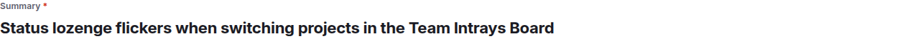" width="900">

<details><summary>The componentDefinition in the picture</summary>

```json
{
  "componentName": "solid-issue-summary",
  "name": "summary",
  "label": "Summary",
  "mandatory": true,
  "fullWidth": true,
  "maxLength": 255
}
```

</details>

**componentDefinition** (`componentName: "solid-issue-summary"`, plus the [common options](#common-options)):

| Option | Type | What it does |
|---|---|---|
| `minLength` | `number` | Fewest characters allowed. |
| `maxLength` | `number` | Most characters allowed. |
| `placeholder` | `string` | Shown when the summary is empty. |
| `headingLevel` | `number` | aria-level of the title (default 1: it is the issue's main heading). |
| `hideLabel` | `boolean` | Hide the label. |

## Fleet

[`solidjs-components-fleet`](solidjs-components-fleet/README.md)

### `<solid-asset-summary>`

The header of an asset: type, ID, registration, lifecycle and hire status, meter, service due (date and meter) and registration warnings, with quick actions that start a booking, a Daily Driver check or a fault report for it.

| | |
|---|---|
| Package | `@solidjs-components-fleet/asset-summary` 0.1.0 · [README](solidjs-components-fleet/components/asset-summary/README.md) |
| Source | [solidjs-components-fleet/components/asset-summary/src/main.tsx](solidjs-components-fleet/components/asset-summary/src/main.tsx) · [AssetSummary.tsx](solidjs-components-fleet/components/asset-summary/src/AssetSummary.tsx) (`AssetSummaryDefinition`) |
| Built bundle | `solidjs-components-fleet/dist/solid-asset-summary/solid-asset-summary.js` |
| In fieldtec-web | `server/public/vendor/custom-component-modules/dist/solidjs-components/solid-asset-summary/solid-asset-summary.js` |

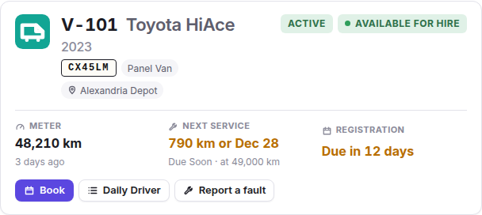" width="608">

<details><summary>The componentDefinition in the picture</summary>

```json
{
  "componentName": "solid-asset-summary",
  "name": "assetSummary",
  "disableSave": true,
  "actions": [
    {
      "label": "Book",
      "icon": "calendar",
      "primary": true,
      "templateId": "template-booking",
      "values": {
        "assetRel": {
          "$asset": {
            "assetId": "assetId"
          }
        }
      }
    },
    {
      "label": "Daily Driver",
      "icon": "list",
      "templateId": "template-daily-driver",
      "values": {
        "assetRel": {
          "$asset": {
            "assetId": "assetId"
          }
        }
      }
    },
    {
      "label": "Report a fault",
      "icon": "wrench",
      "templateId": "template-request",
      "values": {
        "assetRel": {
          "$asset": {
            "assetId": "assetId"
          }
        }
      }
    }
  ]
}
```

</details>

**componentDefinition** (`componentName: "solid-asset-summary"`, plus the [common options](#common-options)):

| Option | Type | What it does |
|---|---|---|
| `fields` | `Partial<AssetSummaryFields>` | Paths on the asset for what the header shows (ID, make, model, registration, meter, service due…), over the fleet defaults. |
| `actions` | `RecordAction[]` | Quick actions; `{ "$asset": { … } }` in `values` puts this asset on the new document (see RecordAction). |
| `leadWeeks` | `number` | "Due soon" this many weeks before a due date, when the service plan doesn't say (default 4). |
| `leadMeter` | `number` | "Due soon" this far before the due meter, when the service plan doesn't say (default 1,000). |

### `<solid-booking-calendar>`

The fleet booking calendar (assets by location × day or week, bookings by status, Hire Overdue, workshop block-outs; drag across free time to book) and, on a booking form, an availability assistant that shows clashes and offers free assets.

| | |
|---|---|
| Package | `@solidjs-components-fleet/booking-calendar` 0.1.0 · [README](solidjs-components-fleet/components/booking-calendar/README.md) |
| Source | [solidjs-components-fleet/components/booking-calendar/src/main.tsx](solidjs-components-fleet/components/booking-calendar/src/main.tsx) · [BookingCalendar.tsx](solidjs-components-fleet/components/booking-calendar/src/BookingCalendar.tsx) (`BookingCalendarDefinition`) |
| Built bundle | `solidjs-components-fleet/dist/solid-booking-calendar/solid-booking-calendar.js` |
| In fieldtec-web | `server/public/vendor/custom-component-modules/dist/solidjs-components/solid-booking-calendar/solid-booking-calendar.js` |

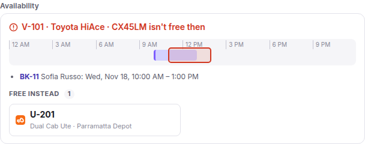" width="608">

<details><summary>The componentDefinition in the picture</summary>

```json
{
  "componentName": "solid-booking-calendar",
  "name": "availability",
  "label": "Availability",
  "mode": "field",
  "disableSave": true,
  "assetFilter": "{'query':{'bool':{'filter':[{'term':{'appTags':'asset'}},{'term':{'bookableBool':true}}]}}}",
  "assetValueFields": {
    "assetId": "assetId",
    "maxBookingHours": "maxBookingHours"
  },
  "bookingFilter": "{'query':{'bool':{'filter':[{'term':{'appTags':'booking'}}],'must_not':[{'terms':{'bookingStatusRel.name':['Cancelled','Closed']}}]}}}",
  "blockFilter": "{'query':{'bool':{'filter':[{'term':{'appTags':'request'}},{'terms':{'requestStatusRel.name':['Drop Off','In Progress','Work Complete']}}]}}}"
}
```

</details>

**componentDefinition** (`componentName: "solid-booking-calendar"`, plus the [common options](#common-options)):

| Option | Type | What it does |
|---|---|---|
| `mode` | `'page' \| 'field'` | "page": the calendar (default); "field": availability for the booking being edited. |
| `bookingTemplateId` | `string` | Template new bookings are made from (dragging across free time, the + on a row). |
| `assetField` | `string` | Fields a new booking (or, in field mode, this booking) keeps its asset and times in. |
| `startField` | `string` | A booking's start (default "startDate"). |
| `endField` | `string` | A booking's end (default "endDate"). |
| `view` | `CalendarView` | "day" (default) or "week". |
| `slotMinutes` | `number` | Snap of drag-to-book, in minutes (default 30). |
| `dayStartHour` | `number` | Hour the day view scrolls to (default 7). |
| `height` | `string` | Height of the calendar, CSS (default 70vh). |
| `hideLabel` | `boolean` | Hide the label. |
| `assetFilter` | `string \| Record<string, unknown>` |   _(CalendarSources)_ |
| `assetFields` | `Partial<AssetFields>` |   _(CalendarSources)_ |
| `assetValueFields` | `Record<string, string>` | Fields copied into a booking's asset value (as the booking's asset picker stores it). _(CalendarSources)_ |
| `bookingFilter` | `string \| Record<string, unknown>` |   _(CalendarSources)_ |
| `bookingFields` | `Partial<BookingFields>` |   _(CalendarSources)_ |
| `blockFilter` | `string \| Record<string, unknown>` |   _(CalendarSources)_ |
| `blockFields` | `Partial<BlockFields>` |   _(CalendarSources)_ |
| `overdueStatus` | `string` | A booking in this status past its end is "Hire Overdue" (default "Hire Commenced"). _(CalendarSources)_ |

### `<solid-meter-reading>`

An odometer (km) or engine hours reading checked against the asset's current meter and an optional start reading, with the change since the asset's last reading.

| | |
|---|---|
| Package | `@solidjs-components-fleet/meter-reading` 0.1.0 · [README](solidjs-components-fleet/components/meter-reading/README.md) |
| Source | [solidjs-components-fleet/components/meter-reading/src/main.tsx](solidjs-components-fleet/components/meter-reading/src/main.tsx) · [MeterReading.tsx](solidjs-components-fleet/components/meter-reading/src/MeterReading.tsx) (`MeterReadingDefinition`) |
| Built bundle | `solidjs-components-fleet/dist/solid-meter-reading/solid-meter-reading.js` |
| In fieldtec-web | `server/public/vendor/custom-component-modules/dist/solidjs-components/solid-meter-reading/solid-meter-reading.js` |

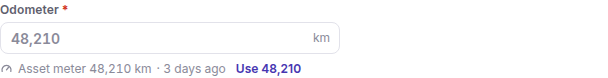" width="608">

<details><summary>The componentDefinition in the picture</summary>

```json
{
  "componentName": "solid-meter-reading",
  "name": "meterReadingNum",
  "label": "Odometer",
  "mandatory": true,
  "maxIncrease": 2000
}
```

</details>

**componentDefinition** (`componentName: "solid-meter-reading"`, plus the [common options](#common-options)):

| Option | Type | What it does |
|---|---|---|
| `assetField` | `string` | Related field holding the asset (default "assetRel"); its current meter is loaded for comparison. |
| `assetMeterField` | `string` | Field on asset documents with the current reading (default "meterReadingNum"). |
| `assetUnitField` | `string` | Field on asset documents with "km" or "hours" (default "primaryMeterUnit"). |
| `assetMeterDateField` | `string` | Field on asset documents with when the reading was taken (default "meterReadingDate"). |
| `unit` | `'km' \| 'hours'` | Unit when the asset doesn't say: "km" (default) or "hours". |
| `minimumField` | `string` | Another field of this document the reading must not be below (e.g. a booking's "startMeterNum"). |
| `maxIncrease` | `number` | Largest believable increase over the asset's meter (flags typos); 0 = no check. |
| `placeholder` | `string` | Text shown while empty. |
| `hideLabel` | `boolean` | Hide the label. |

## Work health and safety

[`solidjs-components-whs`](solidjs-components-whs/README.md)

### `<solid-corrective-actions>`

The corrective actions raised against an incident, hazard or inspection, listed live with their control level, owner, due date and status, and a quick form to raise one.

| | |
|---|---|
| Package | `@solidjs-components-whs/corrective-actions` 0.1.0 · [README](solidjs-components-whs/components/corrective-actions/README.md) |
| Source | [solidjs-components-whs/components/corrective-actions/src/main.tsx](solidjs-components-whs/components/corrective-actions/src/main.tsx) · [CorrectiveActions.tsx](solidjs-components-whs/components/corrective-actions/src/CorrectiveActions.tsx) (`CorrectiveActionsDefinition`) |
| Built bundle | `solidjs-components-whs/dist/solid-corrective-actions/solid-corrective-actions.js` |
| In fieldtec-web | `server/public/vendor/custom-component-modules/dist/solidjs-components/solid-corrective-actions/solid-corrective-actions.js` |

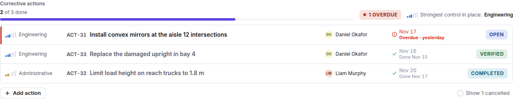" width="900">

<details><summary>The componentDefinition in the picture</summary>

```json
{
  "componentName": "solid-corrective-actions",
  "name": "correctiveActions",
  "label": "Corrective actions",
  "disableSave": true,
  "fullWidth": true,
  "templateId": "template-action",
  "sourceKind": "incident",
  "refField": "incidentRef",
  "ratingField": "riskRating",
  "statusValues": {
    "Open": {
      "documentId": "actionStatus-open",
      "name": "Open",
      "color": "#3e63dd",
      "statusCategory": "todo",
      "indexNum": 10
    },
    "In Progress": {
      "documentId": "actionStatus-in-progress",
      "name": "In Progress",
      "color": "#d97706",
      "statusCategory": "inprogress",
      "indexNum": 20
    },
    "Completed": {
      "documentId": "actionStatus-completed",
      "name": "Completed",
      "color": "#0b8fb3",
      "statusCategory": "inprogress",
      "indexNum": 30
    },
    "Verified": {
      "documentId": "actionStatus-verified",
      "name": "Verified",
      "color": "#2e9d5b",
      "statusCategory": "done",
      "indexNum": 40
    },
    "Cancelled": {
      "documentId": "actionStatus-cancelled",
      "name": "Cancelled",
      "color": "#8b8d98",
      "statusCategory": "done",
      "indexNum": 50
    }
  },
  "controlLevels": [
    {
      "documentId": "controlLevel-eliminate",
      "name": "Eliminate",
      "rank": 1,
      "indexNum": 10
    },
    {
      "documentId": "controlLevel-substitute",
      "name": "Substitute",
      "rank": 2,
      "indexNum": 20
    },
    {
      "documentId": "controlLevel-isolate",
      "name": "Isolate",
      "rank": 3,
      "indexNum": 30
    },
    {
      "documentId": "controlLevel-engineering",
      "name": "Engineering",
      "rank": 4,
      "indexNum": 40
    },
    {
      "documentId": "controlLevel-administrative",
      "name": "Administrative",
      "rank": 5,
      "indexNum": 50
    },
    {
      "documentId": "controlLevel-ppe",
      "name": "PPE",
      "rank": 6,
      "indexNum": 60
    }
  ],
  "people": "{'sort':[{'systemHeader.summaryName':'asc'}],'query':{'bool':{'filter':[{'term':{'systemHeader.systemType':'account'}}]}}}"
}
```

</details>

**componentDefinition** (`componentName: "solid-corrective-actions"`, plus the [common options](#common-options)):

| Option | Type | What it does |
|---|---|---|
| `templateId` | `string` | Template of new corrective actions. Without it there is no Add button. |
| `sourceKind` | `string` | What this record is: "incident", "hazard" or "inspection" (stored in sourceRel.kind). Default "incident". |
| `refField` | `string` | Field of this record with its reference (e.g. "incidentRef"), stored in sourceRel.ref. |
| `ratingField` | `string \| string[]` | Field(s) with the record's rating (e.g. "riskRating", or ["residualRating", "inherentRating"]); the first with a rating wins. |
| `filter` | `string \| Record<string, unknown>` | Elasticsearch request for the actions. Default: whs actions whose sourceRel is this record, by due date. |
| `statusValues` | `Record<string, RelatedDoc>` | Action status values by name; a new action gets `[statusValues.Open]`. |
| `controlLevels` | `RelatedDoc[]` | Control level values to choose from (`{ documentId, name, rank }`), most effective first. |
| `people` | `string \| Record<string, unknown>` | Elasticsearch request for owners (accounts). Default: active accounts. |
| `canAdd` | `boolean` | Offer the Add form. Default true. |
| `addLabel` | `string` | Default "Add action". |
| `showCancelled` | `boolean` | Show cancelled actions at first. Default false (a toggle shows them). |
| `openIn` | `OpenMode` | Where an action opens: "route" (default), "modal" or "newTab". |
| `hideLabel` | `boolean` | Hide the label. |

### `<solid-risk-matrix>`

A 5 × 5 likelihood × consequence matrix. Assess mode rates a risk field (rating, score and what the rating asks for), with the risk before controls as a ghost marker; heatmap mode counts records per cell and lists them.

| | |
|---|---|
| Package | `@solidjs-components-whs/risk-matrix` 0.1.0 · [README](solidjs-components-whs/components/risk-matrix/README.md) |
| Source | [solidjs-components-whs/components/risk-matrix/src/main.tsx](solidjs-components-whs/components/risk-matrix/src/main.tsx) · [RiskMatrix.tsx](solidjs-components-whs/components/risk-matrix/src/RiskMatrix.tsx) (`RiskMatrixDefinition`) |
| Built bundle | `solidjs-components-whs/dist/solid-risk-matrix/solid-risk-matrix.js` |
| In fieldtec-web | `server/public/vendor/custom-component-modules/dist/solidjs-components/solid-risk-matrix/solid-risk-matrix.js` |

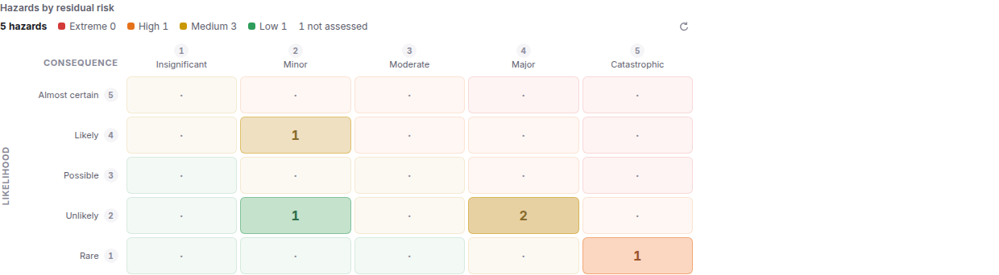" width="900">

<details><summary>The componentDefinition in the picture</summary>

```json
{
  "componentName": "solid-risk-matrix",
  "name": "hazardHeatmap",
  "label": "Hazards by residual risk",
  "mode": "heatmap",
  "disableSave": true,
  "filter": "{'query':{'bool':{'filter':[{'term':{'appTags':'whs'}},{'term':{'appTags':'hazard'}}]}}}",
  "riskField": "residualRisk",
  "noun": "hazard"
}
```

</details>

**componentDefinition** (`componentName: "solid-risk-matrix"`, plus the [common options](#common-options)):

| Option | Type | What it does |
|---|---|---|
| `mode` | `'assess' \| 'heatmap'` | "assess" (default): rate this field's risk. "heatmap": count records per cell (a page element). Read once. |
| `compareField` | `string` | Assess: another risk field of this document, shown as a ghost marker (e.g. "inherentRisk" on the residual risk). Read once. |
| `compareLabel` | `string` | Assess: what the ghost marker is. Default "Before controls". |
| `showResponse` | `boolean` | Assess: show what the rating asks for (due dates, investigation, who is told). Default true. |
| `riskField` | `string` | Heatmap: path of the risk value in each record (e.g. "residualRisk"). |
| `titleField` | `string` | Heatmap: what a record is called in the cell lists. Default "systemHeader.summaryName". |
| `limit` | `number` | Heatmap: most records counted. Default 500. |
| `noun` | `string` | Heatmap: what the records are ("hazard"), for counts. Default "record". |
| `hideLabel` | `boolean` | Hide the label. |

### `<solid-root-cause>`

A five-whys tree for an investigation: the problem, answers to "why?" that can branch, root causes with categories, and what the analysis still needs.

| | |
|---|---|
| Package | `@solidjs-components-whs/root-cause` 0.1.0 · [README](solidjs-components-whs/components/root-cause/README.md) |
| Source | [solidjs-components-whs/components/root-cause/src/main.tsx](solidjs-components-whs/components/root-cause/src/main.tsx) · [RootCause.tsx](solidjs-components-whs/components/root-cause/src/RootCause.tsx) (`RootCauseDefinition`) |
| Built bundle | `solidjs-components-whs/dist/solid-root-cause/solid-root-cause.js` |
| In fieldtec-web | `server/public/vendor/custom-component-modules/dist/solidjs-components/solid-root-cause/solid-root-cause.js` |

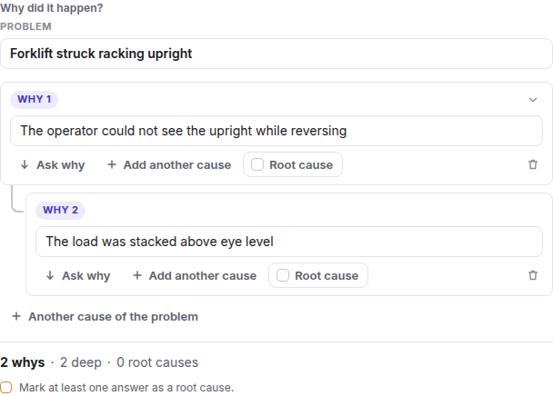" width="608">

<details><summary>The componentDefinition in the picture</summary>

```json
{
  "componentName": "solid-root-cause",
  "name": "rootCauseTree",
  "label": "Why did it happen?",
  "fullWidth": true,
  "problemField": "title",
  "minDepth": 3
}
```

</details>

**componentDefinition** (`componentName: "solid-root-cause"`, plus the [common options](#common-options)):

| Option | Type | What it does |
|---|---|---|
| `problemField` | `string` | Field of this document the problem starts from while the tree has none. Default "title". Read once. |
| `categories` | `(string \| { name?: string })[]` | Root cause categories, as names (or `{ name }`). Default People, Procedure, Plant and equipment, Environment, Organisation. |
| `minDepth` | `number` | Whys a root cause needs above it, itself included. Default 3. |
| `hideLabel` | `boolean` | Hide the label. |

## HR

[`solidjs-components-hr`](solidjs-components-hr/README.md)

### `<solid-leave-balance>`

Leave balances worked out live from the opening balance, pro rata accrual and approved and pending requests. On a leave request: what is available on the first day, this request, and what is left after (writing the available days for the client rule). On a page: the signed-in person's balances as cards.

| | |
|---|---|
| Package | `@solidjs-components-hr/leave-balance` 0.1.0 · [README](solidjs-components-hr/components/leave-balance/README.md) |
| Source | [solidjs-components-hr/components/leave-balance/src/main.tsx](solidjs-components-hr/components/leave-balance/src/main.tsx) · [LeaveBalance.tsx](solidjs-components-hr/components/leave-balance/src/LeaveBalance.tsx) (`LeaveBalanceDefinition`) |
| Built bundle | `solidjs-components-hr/dist/solid-leave-balance/solid-leave-balance.js` |
| In fieldtec-web | `server/public/vendor/custom-component-modules/dist/solidjs-components/solid-leave-balance/solid-leave-balance.js` |

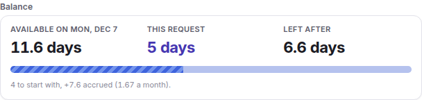" width="608">

<details><summary>The componentDefinition in the picture</summary>

```json
{
  "componentName": "solid-leave-balance",
  "name": "balanceView",
  "label": "Balance",
  "mode": "request",
  "disableSave": true,
  "availableField": "availableDaysNum",
  "leaveTypes": [
    {
      "documentId": "leaveType-annual-leave",
      "name": "Annual leave",
      "color": "#3e63dd",
      "balanceKey": "annual",
      "accrualDaysNum": 20
    },
    {
      "documentId": "leaveType-personal-carer-s-leave",
      "name": "Personal/carer's leave",
      "color": "#12a594",
      "balanceKey": "personal",
      "accrualDaysNum": 10
    },
    {
      "documentId": "leaveType-leave-without-pay",
      "name": "Leave without pay",
      "color": "#8b8d98",
      "balanceKey": "",
      "accrualDaysNum": 0
    }
  ],
  "timeZone": "UTC"
}
```

</details>

**componentDefinition** (`componentName: "solid-leave-balance"`, plus the [common options](#common-options)):

| Option | Type | What it does |
|---|---|---|
| `mode` | `'request' \| 'summary'` | "request" (default): on a leave request; "summary": a person's balances as cards. Read once. |
| `leaveTypes` | `LeaveTypeValue[]` | The leave types (from the lookup), with their balance and accrual. |
| `employeeField` | `string` | Request mode: fields of the request. Defaults employeeRel, leaveTypeRel, startDate, daysNum. Read once. |
| `typeField` | `string` | The request's leave type (default "leaveTypeRel"). |
| `startField` | `string` | The request's first day (default "startDate"). |
| `daysField` | `string` | The request's working days, as `<solid-date-range>` writes them (default "daysNum"). |
| `availableField` | `string` | Request mode: field the days available on the first day are written to, for the client rule. |
| `person` | `'me' \| 'document'` | Summary mode: whose balances: the signed-in person ("me", default) or the account this form shows ("document"). |
| `openingFields` | `Record<string, string>` | Fields on the person's account: the opening balance per balance key, its day, and FTE. |
| `sinceField` | `string` | The day of the opening balances (default "balanceDate"). |
| `fteField` | `string` | The person's FTE, for pro rata accrual (default "fteNum"). |
| `leaveFilter` | `string \| Record<string, unknown>` | Elasticsearch request for the person's leave; `{{employeeId}}` is the person. Default: their leave in the HR app. |
| `timeZone` | `string` | The company's time zone, for "today" and the first day. |
| `hideLabel` | `boolean` | Hide the label. |

### `<solid-org-chart>`

The organisation as a tree of people by whom they report to: cards with team colour, title, reports and who is on leave today; expand and collapse, search that opens the reporting line, zoom, and on a person's form their line and direct reports.

| | |
|---|---|
| Package | `@solidjs-components-hr/org-chart` 0.1.0 · [README](solidjs-components-hr/components/org-chart/README.md) |
| Source | [solidjs-components-hr/components/org-chart/src/main.tsx](solidjs-components-hr/components/org-chart/src/main.tsx) · [OrgChart.tsx](solidjs-components-hr/components/org-chart/src/OrgChart.tsx) (`OrgChartDefinition`) |
| Built bundle | `solidjs-components-hr/dist/solid-org-chart/solid-org-chart.js` |
| In fieldtec-web | `server/public/vendor/custom-component-modules/dist/solidjs-components/solid-org-chart/solid-org-chart.js` |

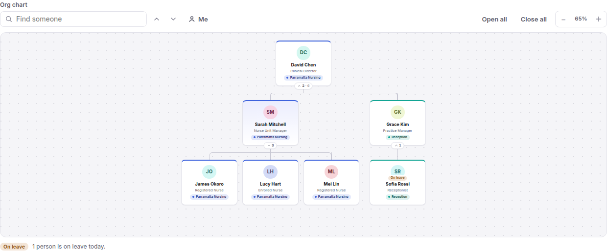" width="900">

<details><summary>The componentDefinition in the picture</summary>

```json
{
  "componentName": "solid-org-chart",
  "name": "org",
  "label": "Org chart",
  "disableSave": true,
  "height": "420px",
  "filter": "{'query':{'bool':{'filter':[{'term':{'systemHeader.systemType':'account'}}]}},'sort':[{'teamRel.indexNum':'asc'},{'systemHeader.summaryName':'asc'}]}",
  "awayFilter": "{'query':{'bool':{'filter':[{'term':{'appTags':'leave'}},{'term':{'leaveStatusRel.name':'Approved'}},{'range':{'startDate':{'lte':'now'}}},{'range':{'endDate':{'gte':'now-1d'}}}]}}}"
}
```

</details>

**componentDefinition** (`componentName: "solid-org-chart"`, plus the [common options](#common-options)):

| Option | Type | What it does |
|---|---|---|
| `filter` | `string \| Record<string, unknown>` | Elasticsearch request for the people. Default: active accounts. |
| `managerField` | `string` | Paths on a person: their manager's id, title, team and the team's colour. |
| `titleField` | `string` | A person's title (default "jobTitle"). |
| `teamField` | `string` | A person's team (default "teamRel.name"). |
| `colorField` | `string` | The team's colour (default "teamRel.color"). |
| `awayFilter` | `string \| Record<string, unknown>` | Elasticsearch request for leave covering today; its people show "On leave". |
| `awayField` | `string` | Path on a leave record to its person's id. Default "employeeRel.documentId". |
| `focus` | `'all' \| 'document'` | "all" (default): everyone; "document": this person's reporting line and direct reports (on a person's form). Read once. |
| `expandDepth` | `number` | Levels open at first. Default 2. |
| `height` | `string` | Height of the chart's viewport. Default "70vh" ("auto" on a person's form). |
| `hideLabel` | `boolean` | Hide the label. |

### `<solid-skills-matrix>`

People × certificate types, each cell valid, expiring (days left), expired or missing against what the person's position requires, grouped by team, with compliance per person, per type and overall, a gaps-only view, search, CSV export, and a click to open or add the certificate.

| | |
|---|---|
| Package | `@solidjs-components-hr/skills-matrix` 0.1.0 · [README](solidjs-components-hr/components/skills-matrix/README.md) |
| Source | [solidjs-components-hr/components/skills-matrix/src/main.tsx](solidjs-components-hr/components/skills-matrix/src/main.tsx) · [SkillsMatrix.tsx](solidjs-components-hr/components/skills-matrix/src/SkillsMatrix.tsx) (`SkillsMatrixDefinition`) |
| Built bundle | `solidjs-components-hr/dist/solid-skills-matrix/solid-skills-matrix.js` |
| In fieldtec-web | `server/public/vendor/custom-component-modules/dist/solidjs-components/solid-skills-matrix/solid-skills-matrix.js` |

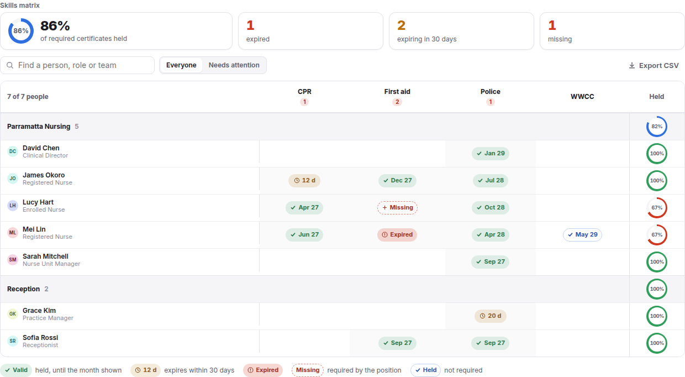" width="900">

<details><summary>The componentDefinition in the picture</summary>

```json
{
  "componentName": "solid-skills-matrix",
  "name": "matrix",
  "label": "Skills matrix",
  "disableSave": true,
  "peopleFilter": "{'query':{'bool':{'filter':[{'term':{'systemHeader.systemType':'account'}}]}},'sort':[{'teamRel.indexNum':'asc'},{'systemHeader.summaryName':'asc'}]}",
  "typesFilter": "{'query':{'bool':{'filter':[{'term':{'appTags':'certType'}}]}},'sort':[{'indexNum':'asc'}]}",
  "filter": "{'query':{'bool':{'filter':[{'term':{'appTags':'certificate'}}]}}}",
  "requiredField": "positionRel.requiredCertsRel.documentId",
  "groupField": "teamRel.name",
  "detailField": "jobTitle",
  "shortField": "shortName",
  "warnDays": 30,
  "templateId": "template-certificate"
}
```

</details>

**componentDefinition** (`componentName: "solid-skills-matrix"`, plus the [common options](#common-options)):

| Option | Type | What it does |
|---|---|---|
| `peopleFilter` | `string \| Record<string, unknown>` | Elasticsearch request for the people (rows). Default: active accounts. |
| `typesFilter` | `string \| Record<string, unknown>` | Elasticsearch request for the certificate types (columns), in order. |
| `filter` | `string \| Record<string, unknown>` | Elasticsearch request for the certificates. Default: the HR app's certificates. |
| `personField` | `string` | Paths on a certificate: its person's id, its type's id, expiry and issue dates. |
| `typeField` | `string` | The certificate type's id (default "certTypeRel.documentId"). |
| `expiryField` | `string` | The expiry date (default "expiryDate"). |
| `issuedField` | `string` | The issue date (default "issuedDate"). |
| `requiredField` | `string` | Path on a person to the type ids their position requires ("positionRel.requiredCertIds"). |
| `groupField` | `string` | Group people by this path ("teamRel.name"), and a second line under each name ("jobTitle"). |
| `detailField` | `string` | A second line under each name ("jobTitle"). |
| `shortField` | `string` | Field of a type with its short name for the header ("shortName"). |
| `warnDays` | `number` | Days ahead that count as expiring. Default 30. |
| `templateId` | `string` | Template of new certificates: an empty cell starts one for that person and type. |
| `personValueFields` | `Record<string, string>` | What a new certificate keeps of its person and type besides documentId and name. |
| `typeValueFields` | `Record<string, string>` | What a new certificate keeps of its type besides documentId and name. |
| `gapsOnly` | `boolean` | Show only people with something to fix at first. Default false. |
| `hideLabel` | `boolean` | Hide the label. |

## Procurement

[`solidjs-components-procurement`](solidjs-components-procurement/README.md)

### `<solid-budget-check>`

A cost centre's budget for the financial year: spent, committed, waiting for approval and what is left, as a bar with the request on it. On a request: whether it fits, and the finance override it needs when it doesn't. On a page: every cost centre against how far through the year it is.

| | |
|---|---|
| Package | `@solidjs-components-procurement/budget-check` 0.1.0 · [README](solidjs-components-procurement/components/budget-check/README.md) |
| Source | [solidjs-components-procurement/components/budget-check/src/main.tsx](solidjs-components-procurement/components/budget-check/src/main.tsx) · [BudgetCheck.tsx](solidjs-components-procurement/components/budget-check/src/BudgetCheck.tsx) (`BudgetCheckDefinition`) |
| Built bundle | `solidjs-components-procurement/dist/solid-budget-check/solid-budget-check.js` |
| In fieldtec-web | `server/public/vendor/custom-component-modules/dist/solidjs-components/solid-budget-check/solid-budget-check.js` |

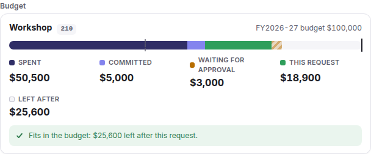" width="608">

<details><summary>The componentDefinition in the picture</summary>

```json
{
  "componentName": "solid-budget-check",
  "name": "budgetView",
  "label": "Budget",
  "mode": "request",
  "disableSave": true,
  "remainingField": "budgetRemainingNum"
}
```

</details>

**componentDefinition** (`componentName: "solid-budget-check"`, plus the [common options](#common-options)):

| Option | Type | What it does |
|---|---|---|
| `mode` | `'request' \| 'summary'` | "request" (default): this request against its cost centre; "summary": every cost centre. Read once. |
| `costCentreField` | `string` | Request mode: the request's cost centre (default "costCentreRel"). Read once. |
| `linesField` | `string` | Request mode: the lines; the amount is their subtotal, ex GST (default "lineItemsArr"). Read once. |
| `remainingField` | `string` | Request mode: field to write what is left before this request (for the client rule). |
| `costCentreFilter` | `string \| Record<string, unknown>` | Summary mode: the cost centres. Default: the app's cost centres. |
| `requestsFilter` | `string \| Record<string, unknown>` | The requests that count against budgets; `{{costCentreId}}` and `{{fy}}` are filled in. Default: the app's requests this financial year. |
| `budgetField` | `string` | The cost centre's budget for the year, ex GST (default "budgetNum"). |
| `baseSpentField` | `string` | What was spent outside the requests this year (default "baseSpentNum"). |
| `codeField` | `string` | The cost centre's code (default "code"). |
| `ownerField` | `string` | Summary mode: who looks after it (default "ownerRel.name"). |
| `emptyText` | `string` | Summary mode: what to say when there are no cost centres (default "No cost centres to show."). |
| `app` | `string` | The app tag of the records (default "proc"). |
| `taxRate` | `number` | Tax rate of the lines (default 0.1): the budget counts amounts ex tax. |
| `currency` | `string` | Currency of amounts (default "AUD"). |
| `timeZone` | `string` | Time zone of days and "today" (default the browser's). |
| `hideLabel` | `boolean` | Hide the label. |

### `<solid-quote-compare>`

A purchase request's supplier quotes side by side: amount against the cheapest, lead time, validity, approved supplier, the quote document; how many quotes the amount needs; choose one; add a quote.

| | |
|---|---|
| Package | `@solidjs-components-procurement/quote-compare` 0.1.0 · [README](solidjs-components-procurement/components/quote-compare/README.md) |
| Source | [solidjs-components-procurement/components/quote-compare/src/main.tsx](solidjs-components-procurement/components/quote-compare/src/main.tsx) · [QuoteCompare.tsx](solidjs-components-procurement/components/quote-compare/src/QuoteCompare.tsx) (`QuoteCompareDefinition`) |
| Built bundle | `solidjs-components-procurement/dist/solid-quote-compare/solid-quote-compare.js` |
| In fieldtec-web | `server/public/vendor/custom-component-modules/dist/solidjs-components/solid-quote-compare/solid-quote-compare.js` |

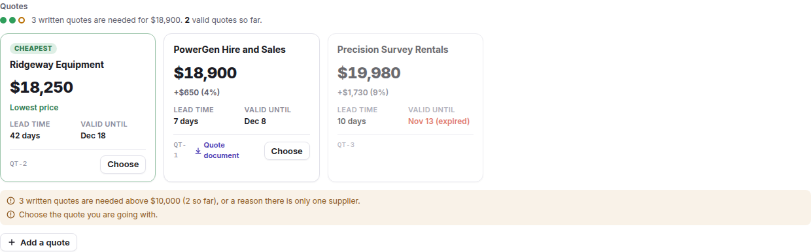" width="900">

<details><summary>The componentDefinition in the picture</summary>

```json
{
  "componentName": "solid-quote-compare",
  "name": "quotes",
  "label": "Quotes",
  "disableSave": true,
  "templateId": "template-quote",
  "rules": [
    {
      "fromAmount": 2000,
      "quotes": 1
    },
    {
      "fromAmount": 10000,
      "quotes": 3
    }
  ],
  "countField": "quotesValidNum",
  "suppliers": "{'query':{'bool':{'filter':[{'term':{'appTags':'supplier'}}]}},'sort':[{'systemHeader.summaryName':'asc'}]}"
}
```

</details>

**componentDefinition** (`componentName: "solid-quote-compare"`, plus the [common options](#common-options)):

| Option | Type | What it does |
|---|---|---|
| `templateId` | `string` | Template of new quotes. Without it there is no Add quote. |
| `rules` | `QuoteRule[]` | How many quotes an amount needs: `[{ fromAmount, quotes }]`. |
| `linesField` | `string` | The request's lines; the amount is their subtotal, ex GST (default "lineItemsArr"). The request's fields are read once. |
| `refField` | `string` | The request's reference, kept on new quotes (default "requestRef"). |
| `chosenField` | `string` | Where choosing a quote writes it (default "chosenQuoteRel"). |
| `supplierField` | `string` | Where choosing a quote writes its supplier (default "supplierRel"). |
| `countField` | `string` | Where to write how many quotes are still valid, for the client rule. |
| `soleSupplierField` | `string` | Why there is only one supplier (default "soleSupplierReason"). This and `notCheapestField` are only read, to say what is still needed. |
| `notCheapestField` | `string` | Why not the cheapest quote (default "notCheapestReason"). |
| `filter` | `string \| Record<string, unknown>` | Elasticsearch request for the quotes. Default: the app's quotes for this request. |
| `suppliers` | `string \| Record<string, unknown>` | Elasticsearch request for suppliers, in the add form. |
| `supplierFields` | `Record<string, string>` | What supplier values keep besides documentId and name. |
| `app` | `string` | The app tag of the quotes (default "proc"). |
| `taxRate` | `number` | Tax rate of the lines (default 0.1): quotes are compared ex tax. |
| `currency` | `string` | Currency of amounts (default "AUD"). |
| `hideLabel` | `boolean` | Hide the label. |

## The kit bundle

Not an element: the runtime every element bundle uses (fields, pickers, the host bridge, styles), loaded once as the global `SolidJsComponentsKit`.

| | |
|---|---|
| Source | [solidjs-components-shared/packages/kit/src/index.ts](solidjs-components-shared/packages/kit/src/index.ts) |
| Built bundle | `solidjs-components-shared/dist/solidjs-components-kit/solidjs-components-kit.js` |
| In fieldtec-web | `server/public/vendor/custom-component-modules/dist/solidjs-components/solidjs-components-kit/solidjs-components-kit.js` |
